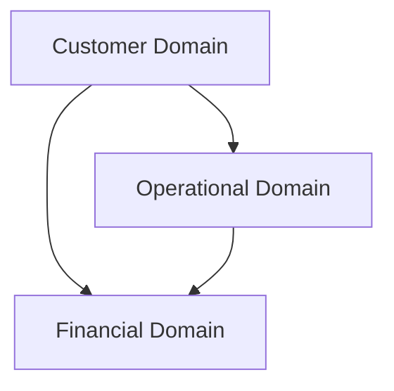

# FlowDock Domain Layers

**Status: Exploratory — not a committed architecture decision.**

This diagram is a sketch of a possible separation between customer, operational and financial concepts. It is not backed by an ADR, and no other document defines these layers or maps existing concepts (Hub, Driver, Asset, etc.) onto them.

FlowDock is deliberately holding off on this layering. Committing to bounded contexts or architectural boundaries before implementation experience reveals where the real boundaries are would be premature, per [Prefer simplicity over premature optimization](../principles.md#prefer-simplicity-over-premature-optimization).

The current architecture continues with a single domain model and clear domain concepts (see [domain-model.md](../../domain/domain-model.md)). Future separation can be introduced when complexity or business requirements justify it, and will be recorded in an ADR at that point.

Do not treat this diagram as settled architecture until that decision is made.

