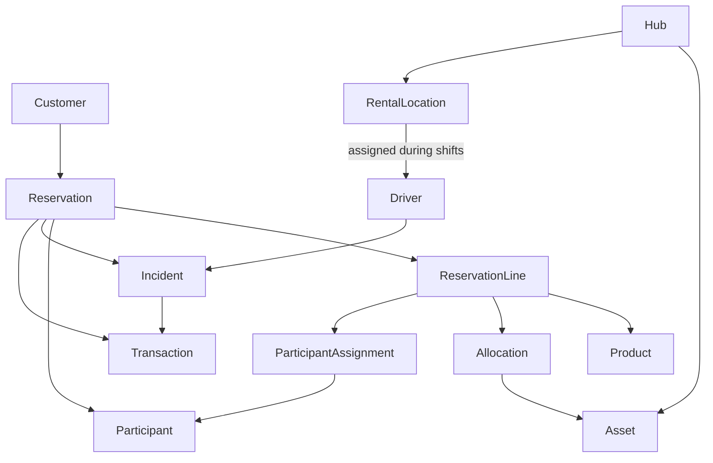

# FlowDock Domain Model

This document describes the main business concepts within FlowDock and their relationships.

The model focuses on business concepts rather than database implementation details.

The domain model evolves as new business decisions are made.

---

# Core Concepts

## Customer

A customer is the person responsible for a reservation.

A customer can create multiple reservations.

A customer who joins the rental is also a participant.

---

## Participant

A participant is a person who uses a rental product but is not necessarily responsible for the reservation.

Example:

A customer reserves two catamarans for four people and joins the rental.

Customer:
- Elton

Participants:
- Elton
- Person A
- Person B
- Person C

---

## Reservation

A reservation represents a customer's request to rent one or more products for a specific period and rental location.

A reservation:

- Belongs to one customer.
- Contains one or more reservation lines.
- May have multiple participants.
- May result in one or more financial transactions.
- Can have operational incidents.
- May be cancelled, with a cancellation reason recorded directly on the reservation (for example: weather, unknown).

A reservation's cancellation reason is not modeled as an incident. Incidents represent events that happen during an active rental; a cancellation prevents the rental from happening at all.

---

## Reservation Line

A reservation line represents a single product within a reservation.

Examples:

- 2 × Electric Catamaran
- 4 × Aperol
- 2 × Chorizo Sandwich

A reservation line:

- References exactly one product.
- Stores the requested quantity.
- May receive one or more allocations.
- May receive one or more participant assignments.
- Represents what the customer has requested.

---

## Participant Assignment

A participant assignment represents a specific participant using a specific reservation line.

Participants are not linked to reservation lines directly. A participant assignment is required because product-specific rules, such as minimum age restrictions, must be validated against the reservation line a participant is actually using, not the reservation as a whole.

Participant assignments are made at booking time, since the customer knows who is using which product when the reservation is created.

Example, Reservation #1042 (Saturday 14:00–17:00, Loosdrechtse Plassen, customer Elton):

| Reservation line | Participant assignments |
| --- | --- |
| 1 × Electric Catamaran | Elton (38), Sanne (36) |
| 2 × SUP with motor | Daan (9), Mila (7) |
| 4 × Aperol | none |

If Elton changes the SUP line to SUP without motor (minimum age 10), FlowDock can tell exactly who is affected: Daan and Mila. Without participant assignments, FlowDock would only know that the reservation includes a 7-year-old, not which product she uses.

---

## Allocation

An allocation represents the assignment of one physical asset to a reservation line.

Assets are not linked to reservation lines directly. An allocation is required because the customer reserves a product, not a specific physical asset — the specific asset is determined separately, during operational planning.

Only reservation lines that require physical equipment receive allocations. A reservation line receives one allocation per asset. Allocations are created by operations and may change before the rental begins.

Example, Reservation #1042 again. Operations plans the allocations from Utrecht Hub:

| Reservation line | Allocations |
| --- | --- |
| 1 × Electric Catamaran | Catamaran #003 |
| 2 × SUP with motor | SUP #015, SUP #016 |
| 4 × Aperol | none (consumable) |

The next morning SUP #015 has a broken motor and goes into maintenance. Operations replaces that allocation with SUP #021. The reservation itself does not change: Elton booked 2 × SUP with motor and still gets exactly that.

### Participant assignment vs allocation

| | Participant Assignment | Allocation |
| --- | --- | --- |
| Connects a reservation line to | Participant | Asset |
| Decided by | Customer | Operations |
| When | At booking | After the booking cutoff, before the allocation deadline |
| Applies to | Lines where rules per person apply | Lines that require physical equipment |

---

## Product

A product represents something FlowDock offers for rental or purchase.

Examples:

- Electric Catamaran
- SUP without motor
- SUP with motor
- Drinks
- Food packages

A product describes what is offered to customers.

A product does not represent a physical item.

Some products require physical assets to fulfill a reservation, while others are fulfilled directly from stock.
---

## Asset

An asset represents a physical item owned by FlowDock.

Examples:

- Catamaran #001
- SUP #015

Assets have:

- Current status
- Location
- Maintenance history
- Assignment history

Assets are assigned through allocations.

---

## Hub

A hub is a central operational location where assets are stored and managed.

Example:

Utrecht Hub

A hub:

- Owns assets.
- Supplies rental locations.
- Coordinates transport.

Asset transport between a hub and a rental location is not modeled as its own concept. This is a deliberate simplification to keep the model simple for now — the `Hub --> Rental Location` relationship is sufficient until a real operational need (for example, tracking who transported which asset and when) justifies introducing a dedicated concept.

---

## Rental Location

A rental location is where customers start and finish their rental.

A rental location:

- Receives assets from a hub.
- Has operational activities.
- Has drivers assigned during operational shifts.

---

## Driver

A driver performs operational tasks.

Drivers are assigned to a rental location during operational shifts.

Examples:

- Transporting assets.
- Preparing rental locations.
- Handling incidents.
- Supporting customers.

Drivers do not modify core reservation data.

---

# Operational Concepts

## Incident

An incident represents an operational event that happens during an active rental.

Incidents happen on the water — they do not include reservation cancellations made before the rental begins. See Reservation's cancellation reason for that case.

Examples:

- Battery empty.
- Customer requires pickup.
- Equipment damage.
- Late return.

An incident records:

- What happened.
- When it happened.
- Which reservation or asset was involved.
- Which driver handled it.
- What actions were taken.

An incident may result in a transaction.

---

## Transaction

A transaction represents a financial event.

Examples:

- Initial rental payment.
- Pickup fee.
- Late return charge.
- Additional drinks purchased.

A transaction records:

- Amount.
- Reason.
- Payment status.
- Related reservation.

A transaction does not replace the operational event that caused it.

---

---

# High-level relationships

